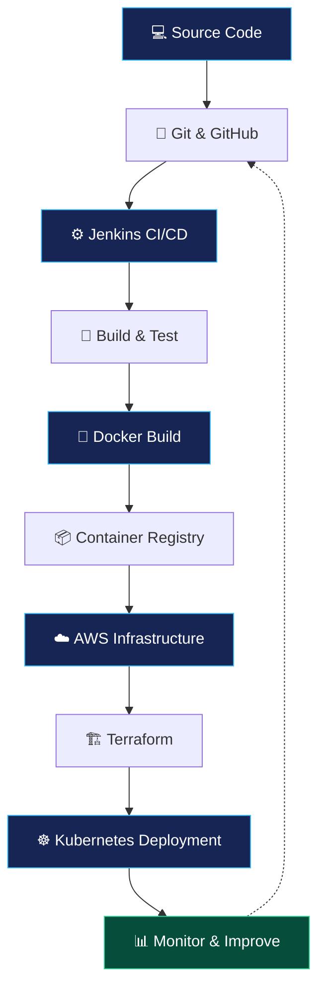

 
 <!-- ===================== PREMIUM DEVOPS HEADER ===================== -->

<div align="center">


<br/>


<br/><br/>

<a href="https://www.linkedin.com/in/vamsi-krishna-analyst-capgemini/">

</a>
<a href="mailto:kvamsikrishna789@gmail.com">

</a>
<a href="https://github.com/kakanivamsikrishna?tab=repositories">

</a>

<br/><br/>


<br/><br/>

**Building reliable infrastructure. Automating everything. Delivering continuously.**

</div>

<!-- =========================== END HEADER =========================== -->

<br/>


<br/><br/>

<a href="https://www.linkedin.com/in/vamsi-krishna-analyst-capgemini/">

</a>
<a href="mailto:kvamsikrishna789@gmail.com">

</a>
<a href="https://github.com/kakanivamsikrishna?tab=repositories">

</a>

<br/><br/>


</div>

---

<!-- ===================================================== -->
<!--                  ABOUT ME                             -->
<!-- ===================================================== -->

## 👨‍💻 About Me

I'm **Vamsi Krishna Kakani**, a DevOps Engineer from India 🇮🇳 passionate about building reliable, scalable and automated infrastructure.

I enjoy working at the intersection of **Development, Operations and Cloud Engineering**, transforming manual processes into automated workflows.

My focus is on creating efficient CI/CD pipelines, containerized applications, cloud infrastructure and deployment automation.

```yaml
name: Vamsi Krishna Kakani
role: DevOps Engineer
location: India 🇮🇳

technical_focus:
  - Linux & Shell Scripting
  - CI/CD Automation
  - Docker & Containerization
  - AWS Cloud Infrastructure
  - Terraform & Infrastructure as Code
  - Kubernetes & Container Orchestration
  - Git & GitHub

currently_interested_in:
  - Cloud Native Technologies
  - DevOps Best Practices
  - Infrastructure Automation
  - Scalable Deployment Architectures

engineering_mindset: "Automate everything. Simplify anything."
```

---

## ⚙️ Technology Ecosystem

<div align="center">

### Operating Systems & Scripting


### Version Control & CI/CD


### Containers & Orchestration


### Cloud & Infrastructure as Code


</div>

---

## 🏗️ What I Work With

| Domain | Technologies |
|:---|:---|
| 🐧 Operating Systems | Linux |
| 💻 Scripting | Bash |
| 🔀 Version Control | Git, GitHub |
| ⚙️ CI/CD | Jenkins |
| 📦 Containerization | Docker |
| ☁️ Cloud Computing | AWS |
| 🏗️ Infrastructure as Code | Terraform |
| ☸️ Orchestration | Kubernetes |
| 🌐 Web & Networking | Nginx, NetworkPolicies |

---

## 🔄 My DevOps Workflow

<div align="center">



</div>

My engineering principles:

- **Automation First:** Eliminate repetitive manual operations.
- **Infrastructure as Code:** Keep infrastructure version-controlled and reproducible.
- **Continuous Delivery:** Build reliable and repeatable deployment pipelines.
- **Security First:** Follow least-privilege access and secure configuration practices.
- **Continuous Improvement:** Monitor, troubleshoot and optimize infrastructure.

---

## 📊 GitHub Analytics

<div align="center">


<br/>


</div>

---

## 🚀 What I'm Building Towards

I believe DevOps is more than knowing tools. It's about understanding how systems work together.

My areas of continued exploration include:

- Designing end-to-end CI/CD pipelines.
- Building containerized application deployment workflows.
- Automating AWS infrastructure with Terraform.
- Managing Kubernetes workloads and networking.
- Improving deployment reliability and infrastructure security.

---

## 🤝 Let's Connect

I'm always interested in connecting with engineers, exploring cloud-native technologies and collaborating on interesting DevOps projects.

<div align="center">

<a href="https://www.linkedin.com/in/vamsi-krishna-analyst-capgemini/">

</a>

<a href="mailto:kvamsikrishna789@gmail.com">

</a>

<br/><br/>

**"Great infrastructure is invisible. Great automation makes it repeatable."**

<br/>


</div>
