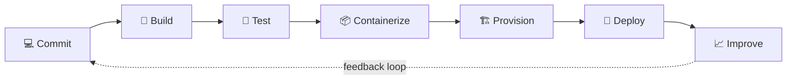

<!-- ============================ HERO ============================ -->
<div align="center">


<a href="https://git.io/typing-svg">
  
</a>

<br/>

<a href="https://www.linkedin.com/in/vamsi-krishna-analyst-capgemini/"></a>
<a href="mailto:kvamsikrishna789@gmail.com"></a>
<a href="https://github.com/kakanivamsikrishna?tab=repositories"></a>


</div>

<br/>

<!-- ============================ ABOUT ============================ -->
## 👋 Hello, World

I'm a **DevOps Engineer from India 🇮🇳** who believes that anything done twice deserves a pipeline.
I design clean, repeatable delivery systems that take code from a commit to production **safely, quickly and without drama**.

```yaml
engineer:
  name: Vamsi Krishna Kakani
  role: DevOps Engineer
  focus: [CI/CD, Containers, Cloud, Infrastructure as Code, Orchestration]
  philosophy: "If I do it twice, I automate it"
  open_to: DevOps and Cloud collaboration
  ask_me_about: [Jenkins, Docker, AWS, Terraform, Kubernetes]
```

<br/>

<!-- ============================ STACK ============================ -->
## 🧰 Tech Stack

<div align="center">


</div>

| Layer | Tools | Level |
|:--|:--|:--:|
| 🐧 **Operating System** | Linux, Bash scripting | ✅ |
| 🔀 **Version Control** | Git, GitHub | ✅ |
| 📦 **Containers** | Docker, multi-stage builds | ✅ |
| ⚙️ **CI/CD** | Jenkins pipelines | ✅ |
| ☁️ **Cloud** | AWS | ✅ |
| 🏗️ **Infrastructure as Code** | Terraform | ✅ |
| ☸️ **Orchestration** | Kubernetes, NetworkPolicies | ✅ |

<br/>

<!-- ============================ ROADMAP ============================ -->
## 🗺️ My DevOps Journey

Every stage of the roadmap is complete. 🎉


| Step | Skill | Status |
|:--:|:--|:--:|
| 1 | Linux | ✅ Done |
| 2 | Git & GitHub | ✅ Done |
| 3 | Docker | ✅ Done |
| 4 | Jenkins (CI/CD) | ✅ Done |
| 5 | AWS | ✅ Done |
| 6 | Terraform | ✅ Done |
| 7 | Kubernetes | ✅ Done |

<br/>

<!-- ============================ HOW I WORK ============================ -->
## 🔁 How I Think About Delivery



- **Automate first** — manual steps are bugs waiting to happen.
- **Everything as code** — pipelines, infrastructure and configuration live in Git.
- **Small, safe, frequent releases** — fast feedback beats big-bang deployments.
- **Secure by default** — least privilege and isolation, from IAM to Kubernetes NetworkPolicies.

<br/>

<!-- ============================ ACTIVITY ============================ -->
## 📊 Activity

<div align="center">


</div>

<br/>

<!-- ============================ CONNECT ============================ -->
## 🤝 Let's Build Something

Looking for a collaborator on **DevOps and Cloud** projects, or just want to talk pipelines? I'd love to hear from you.

<div align="center">

<a href="https://www.linkedin.com/in/vamsi-krishna-analyst-capgemini/"></a>
<a href="mailto:kvamsikrishna789@gmail.com"></a>

<br/><br/>

<sub><i>"Automate the boring stuff, so you can focus on building what matters."</i></sub>


</div>
